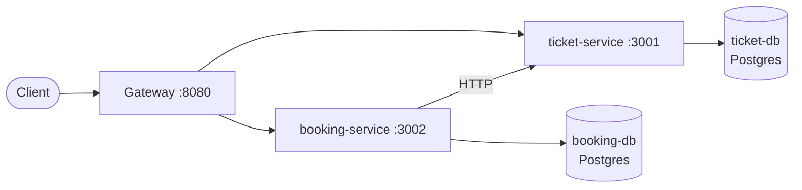

# Ticket Booking – Microservices + API Gateway demo

Each service owns its own Postgres database. Only the gateway is exposed to the host.

## Run
    docker compose up --build

## Auth
- **Public (browser ⇄ gateway):** `POST /auth/login {username, password}` returns a JWT (HS256, 1h). Every other route needs `Authorization: Bearer <jwt>`. Demo users come from `AUTH_USERS` (default `alice:alice123,bob:bob123`); `GET /auth/me` returns the current user.
- **Internal (gateway ⇄ services):** services are only reachable on the private Docker network, so the gateway is the single auth point. It verifies the JWT, strips it, and forwards the username as `X-User`.
- Secrets: set `JWT_SECRET` in the environment (compose has an insecure dev default).

## API (all via the gateway, http://localhost:8080)
| Method | Path | Notes |
|---|---|---|
| GET | /tickets[?status=available] | list tickets |
| GET | /tickets/:id | get one |
| POST | /tickets | `{event, price}` |
| PATCH | /tickets/:id | `{status?, event?, price?, expected_status?}` – `expected_status` makes it compare-and-set (409 on mismatch) |
| POST | /bookings | `{ticket_id, user_name}` |
| GET | /bookings, /bookings/:id | |

## Booking flow
1. `GET` ticket from ticket-service → 409 if not `available`
2. `PATCH` ticket to `booked` with `expected_status: available` (atomic, prevents double booking)
3. Insert booking row; if that fails, the ticket is released again

## Try it
Log in and capture the JWT (requires `jq`):

    TOKEN=$(curl -s -XPOST localhost:8080/auth/login -H 'content-type: application/json' \
      -d '{"username":"alice","password":"alice123"}' | jq -r .token)

Check who you are, then call a protected route:

    curl localhost:8080/auth/me -H "Authorization: Bearer $TOKEN"

    curl -XPOST localhost:8080/bookings -H "Authorization: Bearer $TOKEN" \
      -H 'content-type: application/json' \
      -d '{"ticket_id":1,"user_name":"alice"}'

Without a valid token, protected routes return `401`.

## Seed data
    ./scripts/seed.sh   # wipes tickets + bookings, inserts 10 tickets each for 3 events
    ./scripts/cleanup.sh   # wipes tickets + bookings, leaves tables empty

## Frontend (React + Vite)
    cd frontend && npm install && npm run dev   # http://localhost:5173
The browser calls the gateway directly at `VITE_API_URL` (default `http://localhost:8080`). The gateway allows the dev/preview origins via CORS (`CORS_ORIGIN`, default `http://localhost:5173,http://localhost:4173`).
